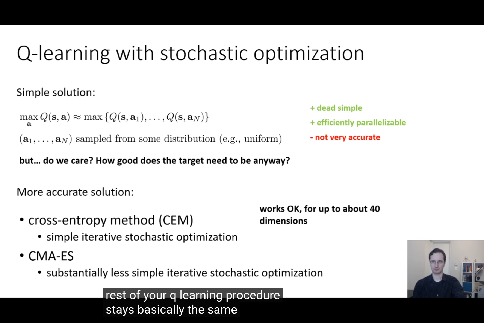
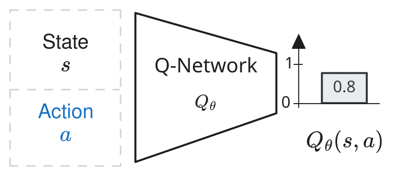
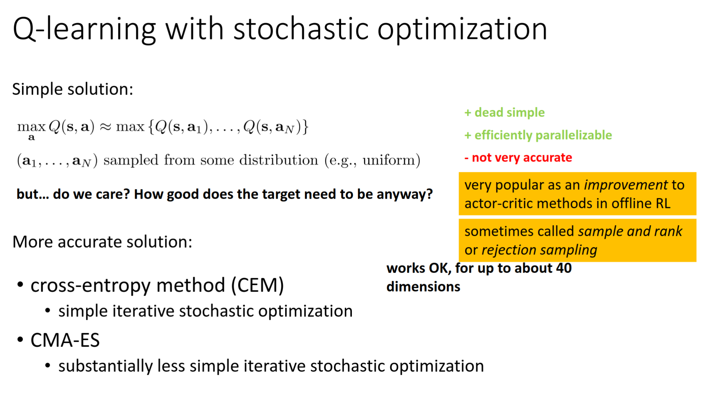

When I was writing my [RL103 blog post](../rl103) on how to start from the Deep Q-Network (DQN) algorithm and extend it little by little to arrive to the Soft-Actor Critic (SAC) algorithm, I realized that a simple intermediate algorithm was always mentioned but never properly studied.
An algorithm that naively sample DQN's $Q$-value to find its maximum.
This blog post is meant to fill this gap and see how far we can go with that simple algorithm.

Spoiler alert: with this very simple algorithm, you can go much further than I thought!

## Extending DQN to Continuous Actions: Again?

When going from the Deep Q-Network (DQN) algorithm to the Soft-Actor Critic (SAC) algorithm, one of the first step is to extend DQN to continuous actions.

At the core of [DQN (see RL102 blog post)](../rl102), the goal is to find the action $a^\star$ that maximizes the current estimated $Q$-value, for a given state $s$.
In the case of discrete actions, this is easy: just enumerate all possible actions $a_i$ and select $a^\star = \mathop{\text{argmax}}_{a_i \in \mathcal{A}}{\ Q\_{\theta}(s, a)}$.
DQN even does that in one forward pass.
<!--In a single forward pass-->

For continuous actions, it becomes tricky because there is an infinite number of actions!
However, that doesn't mean we cannot deal with continuous actions.

In my [RL103 blog post](../rl103), I mention one alternative (restrict $Q$-value function approximator) before presenting the most popular solution (DDPG), which is to train a second network $\pi_{\phi}$ that approximates the maximum.
I also left a small note mentioning a third alternative, "à la QT-Opt"[^qt-opt]: just sample the $Q$-value.
<!--Another alternative is to discretize but that's more taking the problem the other way around-->
<!--Note: in offline RL, some random sampling done and also used in model based RL -->

But, as many resources, including Sergey Levine's tutorial (see below), nothing additional is said about this solution.

<a href="https://youtu.be/Q-Qwjz8Zmh0?si=mHDiR4PJnLbDPiez&t=120">
  
</a>
<p style="font-size: 14pt; text-align:center;">Screenshot from
  Sergey Levine 2018 lecture (CS 185/285 Deep Reinforcement Learning, Decision Making, and Control),
</p>

<!--screenshot from sergey levine lecture
Video: https://www.youtube.com/watch?v=Q-Qwjz8Zmh0 (https://youtu.be/Q-Qwjz8Zmh0?si=mHDiR4PJnLbDPiez&t=120)-->
<!--CS 185/285 Deep Reinforcement Learning, Decision Making, and Control (Spring 2026)
2026: https://youtu.be/lQaVa53pS-Q?si=oKfJxm3F42EbSr7W&t=4283 (1:11:21)
Slides: https://rail.eecs.berkeley.edu/deeprlcourse/static/slides/lec-8.pdf-->

After looking for papers that explore, compare, benchmark this alternative, I only found related ideas[^qt-opt-successors] but not a clear study of this simple extension.
Even QT-Opt only presents a specialized version and no benchmark against alternatives.
This also translates in the fact that no reference implementation can be found in major RL libraries[^sbx].

That's why I decided to start investigating this family of algorithms I call SampleDQN, to see how it compares to the widely studied algorithms like DDPG, SAC or TD3.

## An Impractical Useless Algorithm?

Before I started, I had some hypothesis of why it does not appear in any benchmark/paper:
- the idea is very simple and of course not novel (and therefore would be less flashy[^n-word])
- sampling the $Q$-value might not scale with the dimension of the action space (making the algorithm extremely slow)
- sampling the $Q$-value might be inneficient (need to sample many candidates to find the correct maximum)

Unfortunately, because I couldn't find any prior study[^litterature], I didn't have quantitative results to answer those hypothesis.

However, the simplicity is appealing, and the sampling mechanism could be combined with what SAC/TD3 are using.
That would also be refreshing to have a working algorithm without [37 implementation details](https://iclr-blog-track.github.io/2022/03/25/ppo-implementation-details/) (yes, I'm looking at you PPO ;)).

<!--It would also allow to optimize multimodal value-->

## From DQN to SampleDQN

First, let's review DQN's internals, and see how to extend them to continuous actions.

We are interested in two main components:
1. The exploration mechanism: how to select actions during exploraiton to collect new data?
2. The update mechanism: how to find the maximum of the $Q$-network to perform the gradient update? (the TD backup $Q^{i+1}(s_t, a_t) = r_t + max_{a'} Q^{i}(s_{t+1}, a')$)

### $Q$-network


The first thing to change is the $Q$-network itself.
Instead of having only one input ``q_net(state)`` and outputting all possible actions (`q_value = q_net(state)[0]` for the first action for instance), it should now take directly the continuous action that is evaluated as input: ``q_value = q_net(state, action)``:




### Exploration


During exploration, [DQN](https://github.com/araffin/rlss23-dqn-tutorial) follow an $\epsilon$-greedy exploration that looks like that:

```python
def select_action(...) -> int:
  # Epsilon-greedy exploration
  if np.random.rand() < exploration_rate:
      # Random action
      action = action_space.sample()
  else:
      # Compute q values for all actions
      q_values = q_net(observation)
      # Greedy policy: select action with the highest q value
      action = q_values.argmax()
  return action
```

To make it work with continuous action, we can at first sample actions randomly and keep the one with the highest $Q$-value:

```python
def find_best_action(...) -> np.ndarray:
  # Sample actions (here using a uniform distribution)
  best_q_value = -np.inf
  best_action = None
  for _ in range(n_candidates):
    # candidate_action = sample_action(action_space)
    candidate_action = np.random.uniform(action_low, action_high, size=(action_dim,))
    q_value = q_net(observation, candidate_action)
    # Keep only the action that maximizes the q-value fn
    if q_value > best_q_value:
      best_q_value = q_value
      best_action = candidate_action
  return best_action
```

Note: the current algorithm is very simple but also very inneficient! I'll show later (or in the appendix) how to have an optimized version of it using Jax and vectorization.

You can below an animation of this approximation. As the number of sample action grows ($N \to \infty$), it gets closer and closer to the true maximum:

<video style="min-height: 500px" poster="./img/mpv-shot0005.jpg" controls src="./img/SampleDQN_uniform_sampling.mp4">
</video>
<p style="font-size: 14pt; text-align:center;">Illustration of Uniform sampling to approximate the maximum of $Q_\theta(s, a)$ ($q_\text{max}$)
</p>


Optionally, and similar to what DDPG/TD3 are using, we can add some noise to this selected action to improve exploration (OU noise/Gaussian noise): 
```python
def select_action(...) -> np.ndarray:
  # Find the action that maximizes qf(obs, action)
  # by sampling different candidates
  best_action = find_best_action(q_net, observation)
  # Sample some noise from a Gaussian distribution
  noise = np.random.normal(noise_mean, noise_std)
  # Clip to action space limits
  return np.clip(best_action + noise, action_low, action_high)
```

<!--Note: compared to discrete actions, doing so already introduces a bit of noise-->
<!--TODO: same as DQN/SAC add an algorithm image-->

### Update

same same but with target net, can re-use the `find_best_q_value()` from before.

## Design choices

How does it look like?
what do we need to change from DQN? (give code diff/algo diff)
- sampling function during exploration
- how many candidates to sample during exploration/update
- $Q$-value now takes $a$ as input instead of output
- train function, need to find the max of the target (we keep the target at first)
- to compare to SAC/TD3, we can re-use the cheap twin $Q$-value trick to reduce overestimation
- what do we use to select best action during exploration/gradient update assymetric?

## Benchmark

MuJoCo for a start, maybe Newton/IsaacLab/MJLab later

## Testing the Assumptions

### What maximum does it find?

is it powerful enough to find the max?
yes!
actually it can be to powerful...
like TD3 need a mechanism to avoid overfitting to the small bumps of the target $Q$-value: more $Q$ networks!
(not too costly)

## Is it slow?

<!--Note: gif "baby driver" was he slow?-->
If implemented with Jax (took some iterations, without coding agent), it's actually (and suprisingly) competitive (given some optimizations).

## Does it scale?

enough so far (quadruped, ant, humanoid robot, that's already enough for most applications).
Maybe not to massive sim, need to see...

## Is it good?

On par with SAC/TD3! (at least on MuJoCo)
but that's already surpising

## First Iteration: Uniform Sampling

## Second Iteration: Noisy Cross Entropy Method (CEM)

<video poster="./img/mpv-shot0001.jpg" style="min-height: 500px" controls src="./img/SampleDQN_cem_sampling.mp4">
</video>
<p style="font-size: 14pt; text-align:center;">SampleDQN Uniform sampling
</p>


## Reporting Optimization Cost (Martha White)

detail what are the hyperparameters
- number of sampled actions (exploration/gradient update)
- number of $Q$-values
- batch size
- learning rate
- polyak coeff
- action noise
- NoisyCEM params

## What's next?

Hybrid algorithms (already a bit studied?), learned an actor to make algorithm faster (cheaper than backpropagating through $Q$-value), exploit the multi-modality (multiple strategies?)?


## Citation

```
@article{raffin2026sampledqn,
  title   = "SampleDQN: The Missing RL Algorithm for Continuous Actions",
  author  = "Raffin, Antonin",
  journal = "araffin.github.io",
  year    = "2026",
  month   = "Nov",
  url     = "https://araffin.github.io/post/sampledqn/"
}
```

<!--## Acknowledgement

I would like to thank Anssi and Alison for their feedback =).

All the graphics were made using [excalidraw](https://excalidraw.com/), [manimgx](https://manimgx.academa.ai/) and [latex-to-svg](https://viereck.ch/latex-to-svg/).-->


### Did you find this post helpful? Consider sharing it 🙌

## Footnotes

[^qt-opt]: [QT-Opt](https://arxiv.org/abs/1806.10293)
[^qt-opt-successors]: TBA
[^n-word]: And it would have been rejected for "lack of novelty" despite the insights it could provide.
[^sbx]: Well know, you have an implementation in [SBX](https://github.com/araffin/sbx)
[^litterature]: if you know any prior study that fills that gap, feel free to reach out!
[^offlineRL]: As mentioned in the updated slide (2026) of Levine's course, this is a technique often used in offline RL, but understudied in oneline RL:
<a href="https://youtu.be/lQaVa53pS-Q?si=oKfJxm3F42EbSr7W&t=4283">
  
</a>

<!--Note: in offline RL, some random sampling done -->
